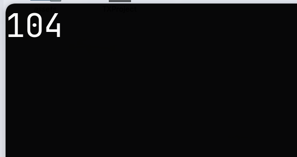

# **UII**
**Unified Interactive Interface is a C++ GUI Libary, pursuing perfection on architecture design.**

# Overview
Project UII is a comprehensive user interface infrastructure framework library, developed under the pursuit of architectural perfection, focusing on readability, expandability and maintainability.

# Screenshot


# Installation
## Build from source
*Make sure CMake, and a viable C++ compiler (recommand g++) is installed.*
**To build:**
1. Download and extract the source code / Clone the repo
2. `cd` into the project directory, and execute the following commands:
```bash
mkdir build && cd build
cmake .. -G Ninja -DCMAKE_BUILD_TYPE=Release
cmake --build .
cd bin
```
**To execute:**
1. Execute the binary via `./TXProject`

## Pre-compiled binary
*The pre-compiled binary attached is targeting Arch Linux x86_64 (7.2.7-arch1-1).*
**To execute:**
1. Download and extract the binary archive
2. Execute the binary via `./TXProject`

# Credit
- Inspired by [Qt](https://www.qt.io/)
- Supported by: [TXLib](https://www.github.com/TXWD1234/TXLib)
- Backed by: [SDL](https://www.libsdl.org/)